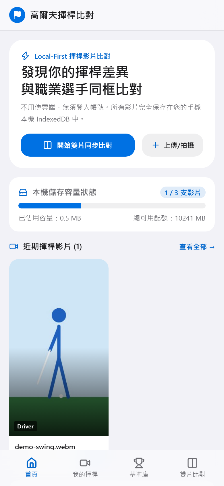
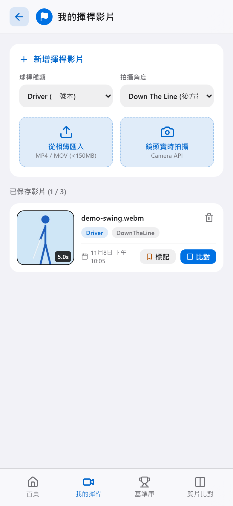
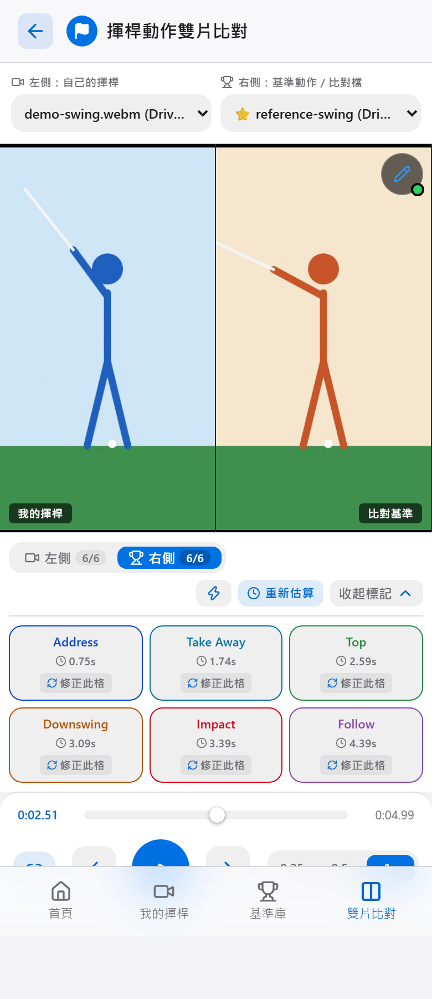

# 高爾夫揮桿比對 (Golf Swing Compare)

手機單手操作的揮桿影片比對工具：把自己的揮桿和基準動作並排同步播放、逐格檢視、標記階段。影片只存在使用者的瀏覽器裡，沒有帳號、沒有雲端、沒有後端。

> **English summary:** A mobile-first, local-first web app for comparing two golf swing videos side by side. Videos and phase markers stay in the browser's IndexedDB, with no account, cloud storage, or API server. Built with Next.js static export, TypeScript, and Dexie.

<p>
  
  
  
</p>

<sub>截圖中的影片是程式產生的火柴人動畫。</sub>

---

## 🌟 功能

- **雙影片同步播放**：支援 0.25x / 0.5x / 1.0x 慢動作與 30 FPS 逐格前後移動。
- **階段調速對齊**：依兩支影片已標記的階段分段調整右側播放速度，讓節奏不同的揮桿也能在各階段盡量同時抵達。
- **揮桿 6 階段標記**：Address、Take Away、Top、Downswing、Impact、Follow Through，點一下即可跳轉。也可依影片長度的固定比例先填入，再手動校正（不會分析影片內容）。
- **手繪輔助線**：在影片上疊一層 Canvas，畫脊椎線、頭部位置或桿頭軌跡。
- **匯入與拍攝**：從相簿選擇，或用 Camera API 錄製最長 30 秒的影片；我的揮桿、基準影片各可保存 3 支。
- **加入主畫面**：可安裝到 iPhone 和 Android 主畫面。目前沒有 Service Worker，開啟時仍需連線。

---

## 🧩 技術重點

| 問題 | 做法 | 位置 |
|---|---|---|
| 兩支節奏不同的揮桿很難對照 | 以已標記階段為關鍵點做分段線性對應，動態調整播放速率，並校正累積漂移 | [`useDualVideoSync.ts`](src/hooks/useDualVideoSync.ts) |
| WebKit 有時無法把 Blob 寫入 IndexedDB | 偵測失敗後改存 ArrayBuffer；影片位元組放在獨立資料表，列表查詢不會把整支影片載入記憶體 | [`videoService.ts`](src/db/services/videoService.ts) |
| 取消錄影時 MediaRecorder 仍會觸發 `stop` | 只有使用者明確按下停止才存檔，取消的影片不會留在裝置上 | [`CameraRecorder.tsx`](src/components/video/CameraRecorder.tsx) |
| Windows 上 Next.js 靜態匯出的預抓路徑會 404 | 建置後攤平區段檔案 | [`flatten-export-segments.mjs`](scripts/flatten-export-segments.mjs) |

**技術棧**：Next.js (App Router, Static Export)、React、TypeScript、IndexedDB + Dexie.js、Tailwind CSS、Motion、Playwright

---

## 📱 頁面

| 路徑 | 內容 |
|---|---|
| `/` | 儲存容量、比對入口、近期影片 |
| `/my-swings` | 匯入、拍攝與管理自己的揮桿 |
| `/pro-library` | 使用者自行上傳的基準影片（專案不附帶任何影片） |
| `/compare` | 雙影片同步比對 |
| `/analysis?id=<影片 ID>` | 單一影片的階段標記 |

---

## 🚀 開發

```bash
npm install
npm run dev        # http://localhost:3000
```

| 指令 | 用途 |
|---|---|
| `npm run lint` | ESLint |
| `npm run typecheck` | TypeScript 型別檢查 |
| `npm run build` | 靜態匯出到 `out/` |
| `npm run test:e2e` | 建置後執行 Playwright 端對端測試（首次需 `npx playwright install chromium`） |

端對端測試涵蓋影片保存、取消錄影不留存、錄影長度、階段估算不重複與檔案大小限制。測試影片由程式即時產生，repo 內沒有任何影片檔。

---

## 🖥️ 部署

輸出是純靜態檔案，任何支援 HTTPS 的靜態主機都可以（鏡頭錄影需要 HTTPS）。

- **Vercel**：匯入 repo 即可，安全標頭已設定在 [`vercel.json`](vercel.json)。
- **Nginx**：[`nginx.conf`](nginx.conf) 為設定範例。Windows 可用部署腳本建置並同步靜態檔，路徑以參數、環境變數 `GOLF_NGINX_DIR` 或 `scripts/deploy.local.ps1`（不納入版控）指定：

  ```powershell
  .\scripts\deploy.ps1 -NginxDir "D:\path\to\nginx"
  ```

請部署在獨立網域。IndexedDB 依 origin 隔離，GitHub Pages 的 `*.github.io` 專案頁會與同帳號的其他專案共用 origin，因此不適合。

---

## 🔒 隱私

- 影片與標記只存在目前瀏覽器的 IndexedDB，不會上傳，也沒有分析追蹤。
- 資料未加密，能使用同一裝置與瀏覽器設定檔的人皆可存取。清除瀏覽器網站資料時，影片也會一併刪除。

---

## 📲 加入主畫面

**iOS Safari**：開啟網址 → 點「分享」→「加入主畫面」。

**Android Chrome**：開啟網址 → 點右上方選單 →「安裝應用程式」或「新增至主畫面」。
